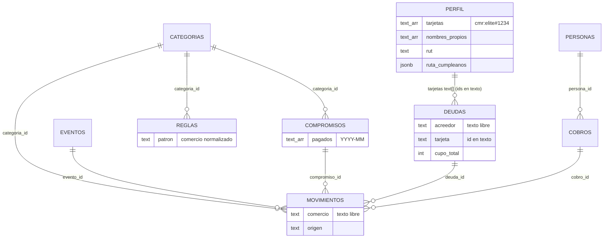
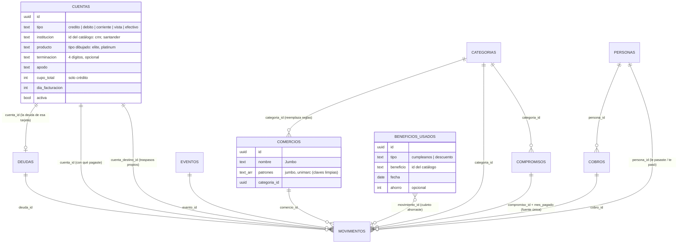

# Modelo de datos de Simplifika

> Describe cómo estaban los datos, qué "datos sueltos" conviene volver
> entidades y en qué orden migrar sin perder nada. **Fases 1 (`cuentas`), 2
> (con qué tarjeta se pagó) y 3 (`comercios`) hechas el 2026-11-02**; las demás
> siguen siendo propuesta.

## La idea en una frase

Cada cosa del mundo real que la persona reconoce (una tarjeta, una cuenta, un
comercio, una persona a la que le presta plata) vive **en un solo lugar** y el
resto la **apunta**. Así la información se recorre de punto a punto:

> movimiento → comercio → descuento que te sirve → con cuál de tus tarjetas →
> cuánto cupo te queda → deuda que crece → plan para pagarla.

Hoy ese recorrido se corta en varios puntos porque hay textos libres
(`comercio`, `acreedor`), listas guardadas dentro de una fila (`perfil.tarjetas`,
`compromisos.pagados`) y dos lugares que dicen lo mismo (`reglas` y
`categorias.palabras`, `pagados` y `movimientos.compromiso_id`).

## Principios

1. **Un dato, un lugar.** Si algo se puede deducir de otra tabla, no se guarda dos veces.
2. **Lo de la persona va en tablas; lo del mundo, en el código.** Bancos, tipos de
   tarjeta, descuentos y regalos de cumpleaños son catálogos que revisa la rutina de
   cada lunes en un PR. Se quedan en `js/` con **ids estables** (`'cmr'`,
   `'cmr:elite'`, `'jumbo'`) y las tablas los apuntan con texto validado por `check`.
   No hay paso de compilación ni una tabla que mantener a mano.
3. **Toda tabla de la persona** tiene `id uuid`, `user_id`, RLS por `user_id` y
   llaves foráneas compuestas `(user_id, id)`, como las de hoy: nadie puede apuntar a
   una fila de otra cuenta.
4. **Expandir, nunca borrar.** `schema.sql` sigue siendo idempotente: agrega tablas
   y columnas y copia los datos, pero las columnas viejas quedan (sin uso) para que
   una versión vieja de la app en caché no se rompa.
5. **Nada sensible.** Una tarjeta nunca guarda más que el banco, el tipo y los
   últimos 4 dígitos.

## Hoy

Dónde se corta el recorrido:

| Dato suelto | Problema | Qué se pierde |
|---|---|---|
| `perfil.tarjetas` (lista de textos) | La tarjeta no tiene fila propia: no puede tener cupo, día de facturación ni gastos propios | "¿Cuánto llevo gastado con la CMR este mes?" |
| `deudas.cupo_total` | El cupo es de la tarjeta, no de la deuda | Ver disponible sin anotar deuda |
| `movimientos.comercio` (texto) | "JUMBO LAS CONDES" y "Jumbo" son dos cosas distintas | Gasto por comercio, cruzar con descuentos |
| `reglas` + `categorias.palabras` | Dos lugares para "este comercio es de tal categoría" | Una sola respuesta, editable |
| `compromisos.pagados` + `movimientos.compromiso_id` | Se marca pagado en tres pantallas distintas, a veces sin movimiento | Saber **cuánto** pagaste y cuándo; puede quedar descuadrado |
| `deudas.acreedor` (texto) | No se sabe que "Falabella" y la CMR son el mismo banco | Agrupar todo lo de un banco |
| `perfil.ruta_cumpleanos` (jsonb) | Los regalos usados viven escondidos en un json | "Este año ahorraste $X con regalos y descuentos" |
| `nombres_propios` / `rut` | Son "mis cuentas" sin decirlo | Reconocer traspasos entre cuentas propias |

## Propuesta

### Las entidades nuevas

**`cuentas`: tus tarjetas y tus cuentas.** Una tarjeta de crédito es una cuenta
de tipo `credito`, y la misma tabla sirve para débito, cuenta corriente, cuenta vista
y efectivo. En la app sigue llamándose "Tus tarjetas"; la tabla es más general para
que mañana quepan las cuentas sin rediseñar.
- `deudas.cuenta_id` reemplaza a `deudas.tarjeta` (el texto). Un índice único parcial
  mantiene la regla "cada tarjeta, una deuda".
- `cupo_total` pasa a la cuenta. La deuda guarda lo que debes.
- `movimientos.cuenta_id`: con qué pagaste. Lo llenan el Atajo de Apple Pay y los
  correos del banco ("terminada en 1234"), o lo eliges tú.
- **Abre:** gastos por tarjeta y por ciclo de facturación, cupo en vivo, "paga con esta
  que tiene descuento hoy", y sincronizar con el banco (open finance) cuenta por cuenta.

**`comercios`: dónde gastas.** Junta las variantes de un mismo comercio y su categoría.
- `claveComercio` (`js/comercios.js`) limpia el texto del banco: sin intermediario
  (`MERPAGO*`), forma legal, números de sucursal ni comuna, y con las marcas
  conocidas ("JUMBO LAS CONDES" → `jumbo`). `patrones` guarda esas claves; si la app
  no unió dos, la persona los junta al editar un gasto ("es el mismo lugar que…").
- `movimientos.comercio_id`; el texto como llegó del banco queda en `comercio`
  (`descripcion` es la nota de la persona).
- `comercios.categoria_id` reemplaza a `reglas` para lo que aprende la app. `reglas`
  se sigue leyendo (lo de antes) y guarda lo de las transferencias, que no son un
  comercio. `categorias.palabras` sigue para palabras genéricas ("farmacia").
- **Sin columna `marca`:** el catálogo de descuentos no tiene ids estables por
  comercio (lo reescribe la rutina de cada lunes), así que el cruce se calcula
  comparando claves (`descuentosEn` en `js/beneficios.js`), sin guardar nada.
- **El paso de los datos lo hace la app, no el SQL:** agrupar variantes necesita la
  limpieza de `claveComercio`, y tenerla en JS y en SQL haría que algún día no
  calcen. `pasarAComercios` corre al abrir la app (también enlaza lo que llegó solo
  del banco), al importar un respaldo y en modo local.
- **Abre:** "¿Dónde más gastaste?" en Gráficos, el descuento que tienes en ese
  comercio al revisar un gasto, y más adelante ofertas por comercio.

**Pagos de compromisos: una sola fuente.** El pago de un mes es el movimiento con
`compromiso_id` y `mes_pagado`. Marcar "pagado" sin monto crea ese movimiento con el
monto del compromiso. `pagados` se sigue leyendo para datos viejos, pero deja de
escribirse.
- **Abre:** historial real ("el arriendo subió en marzo") y un "puedes gastar hoy" que
  siempre cuadra.

**`personas` ↔ `movimientos`.** `movimientos.persona_id` (opcional) y `personas.rut`
(opcional) para transferencias: "le pasaste $20.000 a Cami" calza solo con un cobro.

**`beneficios_usados`.** Sale del json `ruta_cumpleanos.usados` y sirve también para
descuentos. Puede apuntar al movimiento donde lo usaste.
- **Abre:** "este año te ahorraste $X", y saber qué descuentos te sirven de verdad.

### Lo que se queda como está

- **Catálogos en el código** (bancos, tipos de tarjeta, descuentos, regalos): ver principio 2.
- **`movimientos.origen`** (`manual | correo | wallet`) y **`claves_ingreso.fuente`**: son
  pocos valores fijos; un `check` basta.
- **`perfil.revisado_mes`**, **`eventos`**, **`cobros`**: ya son entidades sanas.
- **`perfil.ruta_cumpleanos.elegidos`**: la ruta planeada del año es una preferencia,
  no un hecho; puede seguir en el perfil.

## Cómo migrar (por fases, cada una se puede publicar sola)

Cada fase toca los tres lugares juntos (`schema.sql`, `TABLAS` en `db.js`,
`validar.js`), agrega a `restaurar_respaldo`, convierte respaldos viejos al importar
y migra el modo local al cargar. Además lleva pruebas y `/ecc:security-scan`.

| Fase | Qué | Copia de datos | Riesgo |
|---|---|---|---|
| 1 ✓ | `cuentas` + `deudas.cuenta_id`; `cupo_total` pasa a la cuenta | `perfil.tarjetas` → una fila por tarjeta; `deudas.tarjeta` → `cuenta_id` | Medio: toca Plan, Descuentos y Cumpleaños |
| 2 ✓ | `movimientos.cuenta_id`; Atajo y correos leen los 4 dígitos (`tarjetaDeCompra`); una tarjeta con compras se archiva en vez de borrarse | — | Bajo |
| 3 ✓ | `comercios` + `movimientos.comercio_id`; lo aprendido pasa de `reglas` a `comercios` | En la app (`pasarAComercios`): agrupa `movimientos.comercio` por `claveComercio` | Medio: el clasificador cambia de fuente |
| 4 | Pagos de compromisos como movimientos (`mes_pagado`) | Cada mes en `pagados` sin movimiento → movimiento con el monto del compromiso | Medio: cambia "puedes gastar hoy"; hay que cuidar no contar doble |
| 5 | `beneficios_usados` | `ruta_cumpleanos.usados` → filas | Bajo |
| 6 | `movimientos.persona_id`, `personas.rut`, `cuenta_destino_id` | — | Bajo |

## Riesgos y cómo se cubren

- **App vieja en caché con base nueva:** las columnas viejas no se borran y
  `sinUsuario` sigue omitiendo campos vacíos. Se sube `CACHE` en `sw.js` en cada fase.
- **Base vieja con app nueva** (falta correr `schema.sql`): la app detecta que falta
  la tabla y sigue leyendo lo viejo, como ya hace con `deudas.tarjeta`.
- **Respaldos viejos:** `validar.js` convierte `perfil.tarjetas`, `pagados` y
  `reglas` al formato nuevo al importar. Habrá una prueba por cada conversión.
- **Contar doble** (fase 4): una prueba con un compromiso marcado en `pagados`
  **y** con movimiento verifica que cuenta una sola vez.
- **Seguridad:** RLS y FKs compuestas en cada tabla nueva; `/ecc:security-scan` por fase.
